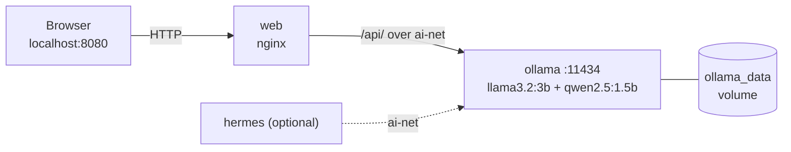

<div align="center">

# Offline AI Assistant

**A private AI chat assistant that runs 100% on your own computer, built with Docker, Ollama and a custom web interface.**


</div>

---

## Table of Contents

- [About the Project](#about-the-project)
- [Features](#features)
- [Architecture](#architecture)
- [Prerequisites](#prerequisites)
- [Installation](#installation)
- [Usage](#usage)
- [Testing Offline](#testing-offline)
- [Source Code](#source-code)
- [Configuration](#configuration)
- [Hermes Agent](#hermes-agent)
- [Command Cheat Sheet](#command-cheat-sheet)
- [Troubleshooting](#troubleshooting)
- [Project Structure](#project-structure)
- [Requirements Checklist](#requirements-checklist)

---

## About the Project

Most AI assistants send your questions to a server on the internet. This project runs the language model **inside Docker on your own machine**, so your questions never leave your computer and the assistant keeps answering with Wi-Fi turned off.

The stack is started with a single command (`docker compose up -d`) and opened in a browser at **http://localhost:8080**.

**Built with:** Docker Compose, Ollama, nginx, HTML, CSS and JavaScript.

---

## Features

- Chat with a local AI model through a clean, minimal website (emerald green and gold theme)
- **Two local models** with a dropdown to switch between them: `llama3.2:3b` and `qwen2.5:1.5b`
- **Streaming answers**: text appears as it is generated
- **Stop** button and **Clear conversation**
- **Live status badge**: shows whether Ollama is reachable and the selected model is installed
- **Speed-tuned requests** for CPU-only machines (short context, answer-length limit, recent history only)
- Services connected through a private **Docker network**
- Models stored in a **Docker volume**, so they survive restarts and work offline
- Optional **Hermes Agent** container (see [Hermes Agent](#hermes-agent))

---

## Architecture



### Services

| Service | Image | Purpose |
|---------|-------|---------|
| `ollama` | `ollama/ollama` | Runs the models locally. Models are stored in the `ollama_data` volume. |
| `model-init` | `ollama/ollama` | One-time job that downloads each model **only if it is missing**, so restarts work offline. |
| `web` | built from `web/Dockerfile` (nginx) | Serves the website and forwards `/api/` requests to Ollama. |
| `hermes` | `nousresearch/hermes-agent` | Optional separate agent (Compose profile `hermes`). |

### How a question travels

1. You type a question on the website.
2. The browser sends it to nginx at `/api/chat`.
3. nginx forwards it over the Docker network `ai-net` to `http://ollama:11434`.
4. Ollama generates the answer with the selected model and streams it back.
5. The website displays the answer as it arrives.

> **Why nginx in the middle?** A browser cannot reach container names such as `ollama`. nginx can, and proxying through it also avoids CORS problems.

---

## Prerequisites

| Requirement | Details |
|-------------|---------|
| Docker Desktop or Docker Engine | With Docker Compose v2 |
| Free disk space | About 5 GB (models are about 3 GB) |
| RAM | 8 GB recommended |
| Internet | **First run only**, to download images and models |
| Git | To clone the repository |

Check your tools:

```bash
docker --version
docker compose version
git --version
```

Make sure Docker Desktop is **running** (the whale icon should say the engine is running).

---

## Installation

### Step 1: Clone the repository

```bash
git clone https://github.com/bangz11/offline-ai-assistant.git
cd offline-ai-assistant
```

### Step 2: Validate the configuration (optional)

```bash
docker compose config -q
```

No output means the file is valid.

### Step 3: Build and start the services

```bash
docker compose up -d --build
```

This pulls the Ollama and nginx images, builds the website image, creates the `ai-net` network and the `ollama_data` volume, and starts everything. **Internet is required for this step.**

### Step 4: Wait for the models to download

```bash
docker compose logs -f model-init
```

The first run downloads both models (about 3 GB). The progress lines repeat many times, which is normal. When the log ends with `success`, press `Ctrl+C` (the containers keep running).

### Step 5: Verify everything is running

```bash
docker compose ps
docker compose exec ollama ollama list
```

- `ollama` and `offline-ai-web` should be running. `model-init` shows *Exited*, which is normal because it is a one-time job.
- `ollama list` should show both `llama3.2:3b` and `qwen2.5:1.5b`.

### Step 6: Warm up the models (recommended)

The first answer after a start is slow because the model has to load into memory. Load each model once:

```bash
docker compose exec ollama ollama run qwen2.5:1.5b "hi"
docker compose exec ollama ollama run llama3.2:3b "hi"
```

After each reply, type `/bye` to leave.

### Step 7: Open the website

Go to **http://localhost:8080**. The badge in the top-right corner should say **Ollama connected**.

---

## Usage

1. Choose a model in the dropdown (`llama3.2:3b` or `qwen2.5:1.5b`).
2. Type a question and press **Enter** (use **Shift + Enter** for a new line).
3. Watch the answer stream in.
4. Press **Stop** to cancel a long answer.
5. Click **Clear conversation** to start fresh.

Tips:

- The smaller `qwen2.5:1.5b` is faster; `llama3.2:3b` gives fuller answers.
- If it shows `...` for a while, the model is loading. Wait and do not press Stop.
- Short questions are answered faster on CPU-only machines.

Stop everything:

```bash
docker compose down        # keeps the downloaded models
```

---

## Testing Offline

1. Complete the [Installation](#installation) steps with internet.
2. **Turn off Wi-Fi** or unplug Ethernet.
3. Restart the stack:
   ```bash
   docker compose down
   docker compose up -d
   ```
4. Open http://localhost:8080 and ask each model a question.
5. It still answers, because the models are in the `ollama_data` volume and the Docker images are cached locally.

> **Warning:** never run `docker compose down -v`. The `-v` flag deletes the volume and the downloaded models.

---

## Source Code

All files are shown below exactly as they run. Click a section to expand it.

<details>
<summary><b>Docker Compose</b> (<code>docker-compose.yml</code>)</summary>

```yaml
name: offline-ai-assistant

services:
  # 1. Ollama: runs AI models locally
  ollama:
    image: ollama/ollama:latest
    container_name: ollama
    volumes:
      - ollama_data:/root/.ollama
    networks:
      - ai-net
    healthcheck:
      test: ["CMD", "ollama", "list"]
      interval: 5s
      timeout: 5s
      retries: 20
    restart: unless-stopped

  # 2. Download models if they are not already installed
  model-init:
    image: ollama/ollama:latest
    container_name: model-init
    depends_on:
      ollama:
        condition: service_healthy
    environment:
      OLLAMA_HOST: http://ollama:11434
    entrypoint: ["/bin/sh", "-c"]
    command:
      - |
        for m in llama3.2:3b qwen2.5:1.5b; do
          if ollama list | grep -q "$$m"; then
            echo "$$m already present - skipping."
          else
            echo "Downloading $$m ..."
            ollama pull "$$m" || exit 1
          fi
        done
    networks:
      - ai-net
    restart: "no"

  # 3. Website: built from web/Dockerfile (nginx), proxies /api/ to Ollama
  web:
    build:
      context: ./web
      dockerfile: Dockerfile
    container_name: offline-ai-web
    ports:
      - "8080:80"
    depends_on:
      ollama:
        condition: service_healthy
      model-init:
        condition: service_completed_successfully
    networks:
      - ai-net
    restart: unless-stopped

  # 4. Hermes Agent: optional terminal-based AI agent
  hermes:
    image: nousresearch/hermes-agent:latest
    profiles:
      - hermes
    depends_on:
      ollama:
        condition: service_healthy
    environment:
      OPENAI_BASE_URL: http://ollama:11434/v1
      OPENAI_API_KEY: ollama
      OPENAI_MODEL: qwen2.5:1.5b
    volumes:
      - hermes_data:/opt/data
    networks:
      - ai-net
    stdin_open: true
    tty: true
    init: true

networks:
  ai-net:
    driver: bridge

volumes:
  ollama_data:
  hermes_data:
```

</details>

**What it does:** defines four services on the `ai-net` network. `ollama` has a health check, `model-init` waits for it and downloads missing models, and `web` starts only after the models are ready. `hermes` is behind a profile, so it does not start by default. `$$m` is Compose's way of writing a literal `$m` for the shell script.

<details>
<summary><b>Website Dockerfile</b> (<code>web/Dockerfile</code>)</summary>

```dockerfile
FROM nginx:1.27-alpine
COPY nginx.conf /etc/nginx/conf.d/default.conf
COPY index.html style.css app.js /usr/share/nginx/html/
EXPOSE 80
```

</details>

**What it does:** starts from the small `nginx:1.27-alpine` image and copies in the nginx configuration and the three website files.

<details>
<summary><b>nginx configuration</b> (<code>web/nginx.conf</code>)</summary>

```nginx
server {
    listen 80;
    server_name _;
    root /usr/share/nginx/html;
    index index.html;

    # Static website
    location / {
        try_files $uri $uri/ /index.html;
    }

    # Browser -> nginx -> Ollama (over the Docker network, hostname "ollama")
    # Proxying avoids CORS problems.
    location /api/ {
        proxy_pass http://ollama:11434/api/;
        proxy_http_version 1.1;
        proxy_set_header Host localhost:11434;   # Ollama accepts localhost host header
        proxy_set_header Connection "";
        proxy_buffering off;                     # needed for streamed tokens
        proxy_read_timeout 600s;
        proxy_send_timeout 600s;
    }
}
```

</details>

**What it does:** serves the static site at `/` and forwards anything under `/api/` to `http://ollama:11434/api/`. `proxy_buffering off` lets streamed words reach the browser immediately, and the long timeouts allow slow first answers on CPU.

<details>
<summary><b>Page structure</b> (<code>web/index.html</code>)</summary>

```html
<!DOCTYPE html>
<html lang="en">
<head>
  <meta charset="UTF-8" />
  <meta name="viewport" content="width=device-width, initial-scale=1" />
  <title>Offline AI Assistant</title>
  <link rel="stylesheet" href="style.css" />
</head>
<body>
  <main class="app">
    <header>
      <div>
        <h1>Offline <span>AI Assistant</span></h1>
        <p class="sub">Running locally via Ollama &middot;
          <select id="model">
            <option value="llama3.2:3b">llama3.2:3b</option>
            <option value="qwen2.5:1.5b">qwen2.5:1.5b</option>
          </select>
        </p>
      </div>
      <div class="status" id="status"><i></i><span>Checking…</span></div>
    </header>

    <section id="chat" class="chat" aria-live="polite">
      <div class="msg bot"><p>Hello! Ask me anything. Everything runs on this computer, no internet needed.</p></div>
    </section>

    <div class="composer">
      <textarea id="input" rows="1" placeholder="Type your question…  (Enter to send, Shift+Enter for new line)"></textarea>
      <button id="send">Send</button>
    </div>
    <button id="clear" class="link">Clear conversation</button>
  </main>
  <script src="app.js"></script>
</body>
</html>
```

</details>

<details>
<summary><b>Styles (emerald and gold theme)</b> (<code>web/style.css</code>)</summary>

```css
:root{
  --emerald-950:#032b20; --emerald-900:#064e3b; --emerald-700:#047857; --emerald-500:#10b981;
  --gold:#d4af37; --gold-light:#f0d77a; --cream:#f8f5e8;
}
*{box-sizing:border-box}
body{margin:0;min-height:100vh;font-family:system-ui,-apple-system,"Segoe UI",Roboto,sans-serif;
  background:radial-gradient(circle at top,var(--emerald-900),var(--emerald-950) 70%);color:var(--cream);
  display:flex;justify-content:center;padding:24px}
.app{width:100%;max-width:820px;display:flex;flex-direction:column;gap:14px;height:calc(100vh - 48px)}
header{display:flex;justify-content:space-between;align-items:flex-start;gap:12px;
  border-bottom:1px solid rgba(212,175,55,.45);padding-bottom:14px}
h1{margin:0;font-size:1.7rem;font-weight:700} h1 span{color:var(--gold)}
.sub{margin:4px 0 0;font-size:.85rem;opacity:.75}
.status{display:flex;align-items:center;gap:8px;font-size:.85rem;padding:6px 12px;border-radius:999px;
  background:rgba(0,0,0,.25);border:1px solid rgba(212,175,55,.35);white-space:nowrap}
.status i{width:9px;height:9px;border-radius:50%;background:#888}
.status.ok i{background:var(--emerald-500);box-shadow:0 0 8px var(--emerald-500)}
.status.err i{background:#e5484d}
.chat{flex:1;overflow-y:auto;display:flex;flex-direction:column;gap:12px;padding:6px 4px}
.msg{max-width:85%;padding:12px 16px;border-radius:16px;line-height:1.5;white-space:pre-wrap;word-wrap:break-word}
.msg p{margin:0}
.msg.user{align-self:flex-end;background:linear-gradient(135deg,var(--gold),var(--gold-light));color:#2a2200;border-bottom-right-radius:4px}
.msg.bot{align-self:flex-start;background:rgba(4,120,87,.35);border:1px solid rgba(16,185,129,.4);border-bottom-left-radius:4px}
.msg.err{background:rgba(229,72,77,.2);border-color:#e5484d}
.composer{display:flex;gap:10px}
textarea{flex:1;resize:none;padding:12px 14px;border-radius:12px;border:1px solid rgba(212,175,55,.5);
  background:rgba(0,0,0,.3);color:var(--cream);font:inherit;max-height:160px}
textarea:focus{outline:2px solid var(--gold)}
button{cursor:pointer;border:0;border-radius:12px;padding:0 24px;font-weight:700;font-size:1rem;
  background:linear-gradient(135deg,var(--gold),var(--gold-light));color:#2a2200}
button:hover{filter:brightness(1.08)} button:disabled{opacity:.5;cursor:not-allowed}
button.stop{background:#e5484d;color:#fff}
.link{background:none;color:var(--gold-light);font-size:.8rem;font-weight:400;align-self:center;padding:2px;text-decoration:underline}
select{background:rgba(0,0,0,.35);color:var(--gold-light);border:1px solid rgba(212,175,55,.5);border-radius:8px;padding:3px 8px;font:inherit}
```

</details>

| Color | Hex | Used for |
|-------|-----|----------|
| Deep emerald | `#032b20`, `#064e3b` | Page background |
| Emerald | `#047857`, `#10b981` | AI message bubbles, "connected" glow |
| Gold | `#d4af37` | Title accent, borders, user messages, Send button |
| Light gold | `#f0d77a` | Gradients and highlights |
| Cream | `#f8f5e8` | Text |

<details>
<summary><b>Chat logic</b> (<code>web/app.js</code>)</summary>

```javascript
const modelSelect = document.getElementById("model");
const getModel = () => modelSelect.value;

const chat = document.getElementById("chat");
const input = document.getElementById("input");
const sendBtn = document.getElementById("send");
const statusEl = document.getElementById("status");

const SYSTEM = {
  role: "system",
  content:
    "You are a helpful offline AI assistant. Answer clearly and directly. " +
    "Keep answers concise unless the user asks for details. " +
    "For simple calculations, answer immediately without unnecessary explanation."
};

let history = [SYSTEM];
let controller = null;

const MAX_HISTORY_MESSAGES = 6;

function addMsg(text, cls) {
  const d = document.createElement("div");
  d.className = "msg " + cls;
  d.textContent = text;
  chat.appendChild(d);
  chat.scrollTop = chat.scrollHeight;
  return d;
}

async function checkStatus() {
  const label = statusEl.querySelector("span");

  try {
    const r = await fetch("/api/tags");
    if (!r.ok) throw new Error("Ollama unavailable");

    const data = await r.json();
    const selected = getModel();

    const ok = (data.models || []).some(
      m => m.name === selected || m.name.startsWith(selected + ":")
    );

    statusEl.className = "status " + (ok ? "ok" : "err");
    label.textContent = ok ? "Ollama connected" : "Model not found";
  } catch {
    statusEl.className = "status err";
    label.textContent = "Ollama unreachable";
  }
}

async function send() {
  const text = input.value.trim();

  if (!text || controller) return;

  input.value = "";
  input.style.height = "auto";

  addMsg(text, "user");

  history.push({
    role: "user",
    content: text
  });

  // Keep the system message and only the latest conversation messages.
  const recentHistory = [
    SYSTEM,
    ...history.slice(1).slice(-MAX_HISTORY_MESSAGES)
  ];

  const bubble = addMsg("Thinking...", "bot");

  controller = new AbortController();

  sendBtn.textContent = "Stop";
  sendBtn.classList.add("stop");

  let answer = "";

  try {
    const res = await fetch("/api/chat", {
      method: "POST",
      headers: {
        "Content-Type": "application/json"
      },
      body: JSON.stringify({
        model: getModel(),
        messages: recentHistory,
        stream: true,
        options: {
          num_ctx: 4096,
          num_predict: 256,
          temperature: 0.3
        },
        keep_alive: "10m"
      }),
      signal: controller.signal
    });

    if (!res.ok) {
      throw new Error(
        "Ollama returned HTTP " + res.status + ": " + await res.text()
      );
    }

    const reader = res.body.getReader();
    const decoder = new TextDecoder();

    let buffer = "";

    while (true) {
      const { value, done } = await reader.read();

      if (done) break;

      buffer += decoder.decode(value, { stream: true });

      const lines = buffer.split("\n");
      buffer = lines.pop();

      for (const line of lines) {
        if (!line.trim()) continue;

        const obj = JSON.parse(line);

        if (obj.error) {
          throw new Error(obj.error);
        }

        if (obj.message?.content) {
          answer += obj.message.content;
          bubble.textContent = answer;
          chat.scrollTop = chat.scrollHeight;
        }
      }
    }

    // Process any final buffered response.
    if (buffer.trim()) {
      const obj = JSON.parse(buffer);

      if (obj.error) throw new Error(obj.error);

      if (obj.message?.content) {
        answer += obj.message.content;
        bubble.textContent = answer;
      }
    }

    if (!answer.trim()) {
      bubble.textContent = "The model returned an empty response. Please try again.";
    }

    // Save only the completed answer to conversation history.
    history.push({
      role: "assistant",
      content: answer
    });

    // Prevent conversation history from growing indefinitely.
    history = [
      SYSTEM,
      ...history.slice(1).slice(-MAX_HISTORY_MESSAGES)
    ];

  } catch (e) {
    if (e.name === "AbortError") {
      bubble.textContent = answer
        ? answer + " [stopped]"
        : "[Response stopped]";

      // Keep a partial answer only if some text was generated.
      if (answer.trim()) {
        history.push({
          role: "assistant",
          content: answer
        });
      }
    } else {
      bubble.textContent = "Error: " + e.message;
      bubble.classList.add("err");

      // Remove the unanswered user message.
      history.pop();
      console.error("Chat request failed:", e);
    }
  } finally {
    controller = null;
    sendBtn.textContent = "Send";
    sendBtn.classList.remove("stop");

    checkStatus();
  }
}

sendBtn.addEventListener("click", () => {
  if (controller) {
    controller.abort();
  } else {
    send();
  }
});

input.addEventListener("keydown", e => {
  if (e.key === "Enter" && !e.shiftKey) {
    e.preventDefault();
    send();
  }
});

input.addEventListener("input", () => {
  input.style.height = "auto";
  input.style.height = Math.min(input.scrollHeight, 160) + "px";
});

document.getElementById("clear").addEventListener("click", () => {
  if (controller) controller.abort();

  history = [SYSTEM];
  chat.innerHTML = "";

  addMsg("Conversation cleared. Ask me anything!", "bot");
});

modelSelect.addEventListener("change", checkStatus);

checkStatus();
setInterval(checkStatus, 15000);
```

</details>

**Speed tuning in `app.js`:**

| Setting | Value | Why |
|---------|-------|-----|
| `num_ctx` | 4096 | Small context window: low RAM use and fast loading |
| `num_predict` | 256 | Caps answer length so replies finish quickly |
| `temperature` | 0.3 | More focused, consistent answers |
| `keep_alive` | `10m` | Keeps the model in memory between questions |
| History | last 6 messages | Keeps each request short |

---

## Configuration

### Change the port

In `docker-compose.yml`, edit the `web` service:

```yaml
    ports:
      - "9090:80"     # now open http://localhost:9090
```

### Add another model

1. Add it to the loop in the `model-init` command:
   ```yaml
   for m in llama3.2:3b qwen2.5:1.5b phi3:mini; do
   ```
2. Add it to the dropdown in `web/index.html`:
   ```html
   <option value="phi3:mini">phi3:mini</option>
   ```
3. Rebuild and download:
   ```bash
   docker compose up -d --build
   docker compose logs -f model-init
   ```

### Use an NVIDIA GPU

Install the NVIDIA Container Toolkit, then add this to the `ollama` service:

```yaml
    deploy:
      resources:
        reservations:
          devices:
            - driver: nvidia
              count: all
              capabilities: [gpu]
```

### Change answer length or speed

Edit `num_predict` and `num_ctx` in `web/app.js`, then run `docker compose up -d --build`.

---

## Hermes Agent

**What it is:** Hermes Agent (by Nous Research) is a separate, terminal-based AI agent.

**Its role here:** it runs in its own Docker container on the same `ai-net` network and is configured with `hermes setup` (saved in the `hermes_data` volume) to use the same Ollama server (`http://ollama:11434/v1`, model `llama3.2:3b`). The connection was verified: Hermes reached Ollama's API.

**What it does not do:** **the website does not use Hermes.** The website talks directly to Ollama through nginx.

**Limitation:** Hermes requires a context window of at least 64,000 tokens. On a CPU-only laptop this needs about 4 GB of extra RAM; Ollama's model process was killed (out of memory), so Hermes could not complete a chat on the development machine. On a computer with more RAM, add this to the `ollama` service:

```yaml
    environment:
      - OLLAMA_CONTEXT_LENGTH=65536
      - OLLAMA_FLASH_ATTENTION=1
      - OLLAMA_KV_CACHE_TYPE=q8_0
```

**Try it (internet needed to pull the image):**

```bash
docker compose --profile hermes pull hermes
docker compose --profile hermes run --rm hermes setup
```

In the setup: choose **Full setup**, then **Custom endpoint**, and enter:

| Prompt | Value |
|--------|-------|
| API base URL | `http://ollama:11434/v1` |
| API key | `ollama` |
| API mode | `2` (Chat Completions) |
| Model | `llama3.2:3b` |
| Context length | `65536` |

Then start it:

```bash
docker compose --profile hermes run --rm hermes
```

---

## Command Cheat Sheet

| Task | Command |
|------|---------|
| Start | `docker compose up -d` |
| Rebuild the website | `docker compose up -d --build` |
| Stop (keep models) | `docker compose down` |
| Service status | `docker compose ps` |
| Logs | `docker compose logs -f ollama web` |
| Installed models | `docker compose exec ollama ollama list` |
| Models in memory | `docker compose exec ollama ollama ps` |
| Validate compose file | `docker compose config -q` |
| Resource usage | `docker stats --no-stream` |

---

## Troubleshooting

| Problem | Fix |
|---------|-----|
| Badge says "Ollama unreachable" | Run `docker compose ps` and wait until `ollama` is healthy |
| Badge says "Model not found" | Run `docker compose up model-init` with internet |
| Stuck on `...` or "Thinking..." | The model is loading. Wait 1 to 2 minutes and do not press Stop |
| Answers are slow | Normal on CPU. Warm up the model, use `qwen2.5:1.5b`, close other programs, raise Docker CPU and RAM limits |
| Old page shown | Press `Ctrl+Shift+R` or run `docker compose up -d --build` |
| Port 8080 already in use | Change `"8080:80"` in `docker-compose.yml` |
| Compose file error | Run `docker compose config -q` to see the line |
| `model-init` fails offline | Models are already installed; check `ollama list`. A fresh volume needs internet once |

---

## Project Structure

```
offline-ai-assistant/
├── docker-compose.yml     # services, network (ai-net), volumes
├── README.md
├── PRESENTATION.md        # demo steps and speaking script
├── .gitignore
└── web/
    ├── Dockerfile         # nginx image for the website
    ├── nginx.conf         # serves the site, proxies /api/ to Ollama
    ├── index.html         # page and model selector
    ├── style.css          # emerald and gold theme
    └── app.js             # chat logic, streaming, status badge
```

---

## Requirements Checklist

| # | Requirement | Status |
|---|-------------|--------|
| 1 | Docker Compose runs the services | Done |
| 2 | Hermes Agent in a Docker container | Runs and connects to Ollama; chat needs more RAM ([details](#hermes-agent)) |
| 3 | Ollama in Docker with `llama3.2:3b` | Done (plus `qwen2.5:1.5b`) |
| 4 | HTML/CSS/JS website, emerald and gold | Done |
| 5 | Users ask questions and get local answers | Done |
| 6 | Works offline after downloads | Done, tested with Wi-Fi off |
| 7 | Containers communicate over a Docker network | Done (`ai-net`) |
| 8 | GitHub with source, Dockerfile, compose, README | Done |

---

<div align="center">

Author: [bangz11](https://github.com/bangz11)

</div>
